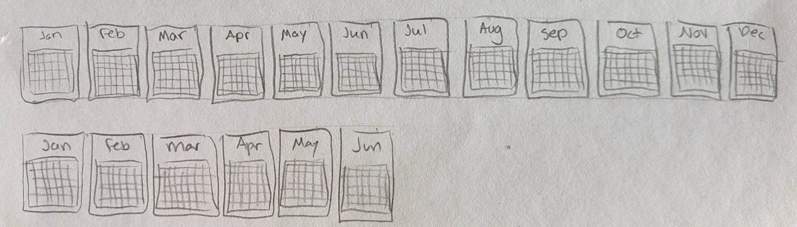

# AutoMetaPIA

**Automated Meta-Research - People Incorporating AI**

### Goal: to help academic librarians and researchers decide which knowledge-synthesis tools to use by facilitating structured comparisons of those tools.

## Components of the project

- In order to compare tools, we need to gather information about those tools into consistent structured metadata records.
- You can use **[AutoMeta Generator](https://autometapia.github.io/autometa-generator)** to create metadata records.
- You can refer to **[AutoMeta Vocab](https://autometapia.github.io/autometa-vocab/)** to find terms to use in the metadata records.

## Want to contribute metadata?

### Practice creating a metadata record

- Learn about the [ASReview](https://asreview.nl/) software
- Learn about some of the automation methods used in the software, described in this paper: [An open source machine learning framework for efficient and transparent systematic reviews](https://doi.org/10.1038/s42256-020-00287-7).
    - Section in the paper where they describe the machine-learning model: [Pipeline for manual and machine learning-aided systematic reviews](https://www.nature.com/articles/s42256-020-00287-7#Sec2).
- Create a metadata record
  - Fill in metadata fields using the [AutoMeta Generator](https://autometapia.github.io/autometa-generator).
  - Refer to this [Metadata Application Profile (MAP)](https://docs.google.com/spreadsheets/d/1Ml5YLQB-3Z8FeyyUeAVYbne98BJqsKlo7vhy9KC7O6c/edit?usp=sharing) for instructions on how to fill out each field.
  - Refer to [AutoMeta Vocab](https://autometapia.github.io/autometa-vocab/) to find terms to use in the metadata records.
  - Click "Preview JSON" at the bottom of the AutoMeta Generator form to see the JSON file for your record
- Submit the JSON record by pasting it in this [Google Form](https://forms.gle/W63VMCAc3haeEMx27)

## Background to the larger AutoMetaPIA project

### Knowledge synthesis is important.

- Your doctor may refer to a systematic review (a type of knowledge synthesis) to decide which drugs to prescribe to you.
- A policy make may refer to a systematic review to decide whether a public health initiative should be publicly funded.

### It gets harder and more important as the research literature expands.

#### A systematic review takes an average of 16 months to complete

### Automation can make knowledge synthesis more efficient.

### Some methods of automation are more or less transparent, reproducible, and ethical.

- E.g., some AI tools are 'black boxes' that can't explain how they reached their conclusions/results (poor transparency), give different results when used repeatedly (poor reproducibily), and involved allegedly violating copyright during model training (ethical consideration).
- These are key considerations in knowledge synthesis, since it is the highest level of evidence and must be held to a high standard.

### We need to be able to make informed choices about which tools to use.

- It can take a lot of digging to figure out how automation features work in different tools.

## References

Adam, D. (2025). The peer-review crisis: How to fix an overloaded system. Nature, 644(8075), 24–27. https://doi.org/10.1038/d41586-025-02457-2

Baicker, K., & Chandra, A. (2017). Evidence-Based Health Policy. New England Journal of Medicine, 377(25), 2413–2415. https://doi.org/10.1056/NEJMp1709816

Borah, R., Brown, A. W., Capers, P. L., & Kaiser, K. A. (2017). Analysis of the time and workers needed to conduct systematic reviews of medical interventions using data from the PROSPERO registry. BMJ Open, 7(2), e012545. https://doi.org/10.1136/bmjopen-2016-012545

Bugajska, J. V., Hild, B. F., Brüschweiler, D., Meier, E. D., Bannach-Brown, A., Wever, K. E., & Ineichen, B. V. (2025). How long does it take to complete and publish a systematic review of animal studies? BMC Medical Research Methodology, 25, 226. https://doi.org/10.1186/s12874-025-02672-5

Clark, J., Glasziou, P., Mar, C. D., Bannach-Brown, A., Stehlik, P., & Scott, A. M. (2020). A full systematic review was completed in 2 weeks using automation tools: A case study. Journal of Clinical Epidemiology, 121, 81–90. https://doi.org/10.1016/j.jclinepi.2020.01.008

Connor, L., Dean, J., McNett, M., Tydings, D. M., Shrout, A., Gorsuch, P. F., Hole, A., Moore, L., Brown, R., Melnyk, B. M., & Gallagher-Ford, L. (2023). Evidence-based practice improves patient outcomes and healthcare system return on investment: Findings from a scoping review. Worldviews on Evidence-Based Nursing, 20(1), 6–15. https://doi.org/10.1111/wvn.12621

Currie, G. M. (2026). Artificial intelligence: Moving fast, understanding slowly. Are we leading or just reacting? Radiography, 32(3), 103385. https://doi.org/10.1016/j.radi.2026.103385

Giustini, D. M. (2025). Undermind.ai (product review). Journal of the Canadian Health Libraries Association / Journal de l’Association Des Bibliothèques de La Santé Du Canada, 46(2), 42–46. https://doi.org/10.29173/jchla29854

Kitchin, V. (2026). Rayyan.ai (product review). Journal of the Canadian Health Libraries Association / Journal de l’Association Des Bibliothèques de La Santé Du Canada, 47(2). https://doi.org/10.29173/jchla29964

Knowles, M., Holton III, E., & Swanson, R. (2014). The Adult Learner: The Definitive Classic in Adult Education and Human Resource Development. Routledge.

Landhuis, E. (2016). Scientific literature: Information overload. Nature, 535(7612), 457–458. https://doi.org/10.1038/nj7612-457a

Lo, L. (2024). Evaluating AI Literacy in Academic Libraries: A Survey Study with a Focus on U.S. Employees. College & Research Libraries, 85(5). https://doi.org/10.5860/crl.85.5.635

Lo, L. S., & Anderson, V. (2024). AI Reskilling in Libraries: When the Dean’s Assistant Gets an AI Assistant. College & Research Libraries News, 85(6), 258. https://doi.org/10.5860/crln.85.6.258

Minion, J., Egunsola, O., Mastikhina, L., Farkas, B., Hofmeister, M., Flanagan, J., Salmon, C., & Clement, F. (2021). PICO Portal (product review). Journal of the Canadian Health Libraries Association / Journal de l’Association Des Bibliothèques de La Santé Du Canada, 42(3). https://doi.org/10.29173/jchla29590

Oxford Centre for Evidence-Based Medicine: Levels of Evidence (March 2009). (n.d.). [Web Page]. Retrieved October 5, 2023, from https://www.cebm.ox.ac.uk/resources/levels-of-evidence/oxford-centre-for-evidence-based-medicine-levels-of-evidence-march-2009

Premji, Z., Parker, R., Monique, C., Bhatnagar, N., & Maimets, I.-K. (2024). Canadian Academic Library Workers Supporting Knowledge Synthesis: CARL Needs Assessment Survey Final Report (p. 32). Canadian Association of Research Libraries. https://www.carl-abrc.ca/wp-content/uploads/2024/05/CARL-KS-Needs-Assessment-Survery-Report-April-2024.pdf

Shojania, K. G., Sampson, M., Ansari, M. T., Ji, J., Doucette, S., & Moher, D. (2007). How quickly do systematic reviews go out of date? A survival analysis. Annals of Internal Medicine, 147(4), 224–233. https://doi.org/10.7326/0003-4819-147-4-200708210-00179

The Pulse of the Library. (2024). Clarivate. https://doi.org/10.14322/pulse.of.the.library.2024

